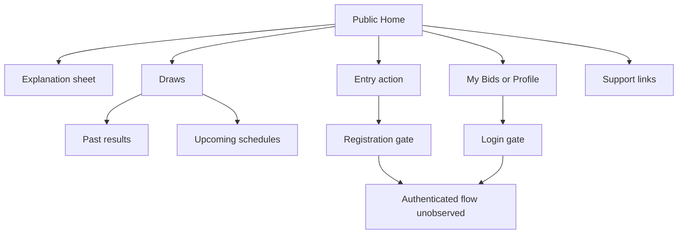

# Onebid public website review

Inspection date: 23 October 2026. Target: [onebid.et](https://onebid.et/). This is a bounded, anonymous public-site review to inform an original Lowin interface. It is not an audit of Onebid's financial correctness, security, winner consent or private administration.

## Method and evidence boundary

The REA `reverse-engineer-anything` skill and its runtime-observation guide were used. A declared browser scenario captured the public homepage through the connected REA MCP tools. `analyze_web_bundle` then closed the MCP transport without returning usable analysis. No conclusion below relies on that failed operation.

An already-cached REA 6.7.0 public CLI continued the work without installation or configuration changes. Its `inspect-web-page` captured 22 observed script records; 21 same-origin external JavaScript artifacts were retained. Its `capture-browser-scenario` executed declared navigation, clicks and bounded waits. It captured Home, the explanation sheet, anonymous bid/account gates, Draws, login/register forms, terms, support and the language menu. These are actual REA CLI observations, not a substitute mock application. A small local Node inspection searched the retained public scripts and CSS for specific technology and route markers; those results are identified separately as static evidence.

The initial connected-browser captures produced a desktop viewport with a narrow app column; their requested mobile emulation did not establish mobile dimensions. Separate REA-owned launch scenarios used an actual 390 × 844 viewport and captured Home, its explanation sheet and support. The owned temporary scenario browsers were reported terminated by REA. Reduced motion was requested. Android/iOS Telegram WebViews, touch keyboards, assistive technology, slow-network performance and authenticated behavior were not tested.

No account was created, form submitted, message sent, bid entered or payment initiated. No login bypass, endpoint enumeration or admin scan was attempted. The normal site automatically sent analytics requests and loaded a YouTube embed when its explanation sheet opened; those page-generated requests are not evidence of a financial mutation.

All third-party source, DOM/accessibility captures and screenshots are outside this repository at `D:/lowin-redesign-qa/onebid-research`. This document contains original analysis only. Do not copy those assets, winner photographs, legal copy or promotional claims into Lowin.

## Technology findings

| Finding | Classification and basis | Confidence / limit |
| --- | --- | --- |
| React and React DOM | Captured [client code](https://onebid.et/assets/index-DvtaRGL2.js) and shared React modules contain renderer/version declarations for **19.2.8**. | Observed bundle declarations; not a verified package lock or backend inventory. |
| Vite build output | Captured modules contain `__vite__mapDeps`, hashed asset imports and `VITE_API_BASE_URL`. | Strong static evidence of Vite-produced client assets; deployed build configuration is unavailable. |
| Tailwind CSS | The delivered [stylesheet](https://onebid.et/assets/styles-BYdmUSSQ.css) begins with a Tailwind CSS **4.3.3** attribution. | Observed stylesheet declaration. |
| TanStack Router | Captured code contains TanStack router reload/storage and scroll-restoration markers, route chunks and match components. | Strong static fingerprint; exact router dependency version unknown. |
| TanStack Query | Captured code contains QueryClient/provider conventions, query cache/default-query behavior, stable query keys and payment-method query caching. | Strong static fingerprint; exact dependency version unknown. |
| TanStack Start | Captured configuration declares `TSS_SERVER_FN_BASE` and a server-function base path. | Inferred framework use. This does not establish server language, hosting architecture or execution of every included function. |
| Typography | Document font CSS requests Outfit, DM Sans and Noto Sans Ethiopic. Shipped CSS assigns DM Sans/Ethiopic to body text and Outfit/Ethiopic to display text. | Observed declarations and visual appearance; font loading was not profiled on actual devices. |
| API separation | Normal Home loading requests `https://api.onebid.et` for tenant configuration, payment methods, open auctions and past auctions. | Observed runtime requests returning HTTP 200 in the initial scenario. No private API was manually called. |
| Asset delivery | Public images load from a DigitalOcean Spaces CDN hostname. The public stylesheet response identifies Cloudflare. | Observed delivery endpoints/response header; this does not reveal the origin server's stack. |
| PWA support | The page declares a web manifest and install icons; an install-prompt module is loaded. | Observed declarations/module. Offline behavior and installability were not exercised. |
| Notifications | The page includes a toast region; captured client CSS contains Sonner markers. | Observed client implementation marker. Private notification-center behavior remains unknown. |

There is no supported basis here to claim Next.js, Laravel, Django, a particular database, cloud origin, job system or admin framework. Trailing-slash API URLs and client-visible route names are not backend identification.

## Public customer flows

| Surface / action | Observed behavior | Remaining boundary |
| --- | --- | --- |
| Launch | A small loading indicator with concise auction-loading text appears while the bottom navigation remains present. It resolves to the public catalogue in the captured sessions. | No failed-load/retry or unusually slow connection was induced. |
| Home | Rounded white header; logo, anonymous account actions and language control; a dark photographic promotional banner; short introduction with two actions; horizontal sorting controls; a single-column auction list; recent results; explanatory content; footer; fixed navigation and floating support. | Banner composition and result images are Onebid-owned material, not Lowin assets. |
| Sorting | The current public controls offer default order, end time, recency and fee order. | This differs from the older duration-category chips in the supplied screenshots. Sorting correctness across all listings was not exhaustively tested. |
| Auction cards | Large product image, small status badge, short product name, fee and countdown chips, one prominent entry action, fee caveat and a quieter schedule/reference line. Eleven live listings appeared in the initial Home session. | Product availability, stock, rule enforcement and actual deadlines were not independently verified. |
| Explanation | The introduction opens a tall, rounded sheet with close control, embedded YouTube content, three numbered steps and an example block. Background content remains visually present under a dark scrim. | Video playback, focus trap, dismissal by keyboard and long-sheet touch scrolling were not exhaustively tested. |
| Anonymous entry action | Clicking a live card's entry action opens account registration, rather than exposing the authenticated payment/bid sheet. | No live bid sheet, fee submission, authorization, payment return or receipt was observed. The supplied reference screenshots are separate evidence of their photographed states. |
| Recent results | Home contains a result rail and a link to Draws. Cards display product imagery, announcement dates and published result amounts. | These are publisher claims. This review does not verify settlement records, identities, consent or prize delivery. |
| Draws | [Draws](https://onebid.et/draws) opens past results by default, with a two-way past/upcoming control. Past entries link to result-detail destinations. | A bounded list was inspected; no full history or private settlement information was acquired. |
| Upcoming | Switching tabs replaces result cards with compact horizontal rows: thumbnail, title, schedule, fee and countdown. | The captured list is not visibly chronological, so it should not be treated as a model for guaranteed schedule ordering. |
| Login | An account sheet shows a login/register tab switch, Ethiopian phone prefix, password input, primary submit action and password-recovery entry. | No credentials, recovery request, OTP or authenticated response was submitted. |
| Registration | The sheet shows phone and password inputs, a terms link and an agreement checkbox. The checkbox was already checked in the captured state. | Treat this as an observation, not a consent pattern to adopt. Registration, verification and validation behavior remain unknown. |
| My Bids / Profile | Anonymous taps open login. | Account editing, bid summaries/details, balance, coupons, wins and private notification UI were not available without authentication. |
| Support | A compact black floating button opens a rounded contact sheet with Telegram, WhatsApp, phone and email links. | Links were inspected, not activated; no message or call was sent. |
| Language | The header opens an English/Amharic selection menu. | Public localization was inspected separately from the legal content; no claim of complete translation coverage is made. |
| Terms | The visible footer links to [Terms](https://onebid.et/terms). The document is a long, numbered Amharic article with an update date, within a simple page header/back control. The surrounding language control initially still displayed English. | This is not a legal interpretation or a verification of operational compliance. No privacy link surfaced in the inspected Home/terms UI or bounded captured route strings; that does not prove a privacy policy is absent elsewhere. |

## Public-code workflow candidates, not tested workflows

The captured client contains candidates for account registration/token/recovery, paginated bids, coupons, referrals, notifications, bid submission, payment authorization/status, and public result-number displays. These strings help explain the client architecture and which areas require authorized access. They were **not invoked manually**, and their presence does not establish that a feature is enabled, secure, operational or exposed to every user.

The client separates catalogue and historical-result reads from private account actions, loads several modules as separate chunks, and caches some stable configuration reads. Those are useful architectural patterns to consider. Neither static cache settings nor a successful desktop navigation establishes a mobile launch speed, p95 API latency, reliability target or production capacity.

## Admin boundary

No admin entry was exposed in the inspected normal customer links, and no admin route candidate surfaced in the 21 retained same-origin external scripts. This is a bounded negative observation, not proof that an admin application does not exist. No guessed admin URL, hidden endpoint, sign-in bypass or privileged account was attempted.

Admin navigation, auction creation/moderation, participant records, settlement controls, payment review, audit access, staff permissions and winner-consent workflows are **unknown**. Designing Lowin administration should follow Lowin's actual operations and permission model, not an invented reconstruction of Onebid's private system.

## Original Lowin design implications

1. Keep one dominant task per screen. A short introduction, visible fee/status and one primary card action reduce the effort needed to understand an auction.
2. Use a consistent spacing and type hierarchy: compact metadata, readable product names, restrained display text and generous sheet sections. The shape and rhythm can inform Lowin without copying exact components or words.
3. Keep public artwork/fonts independent of authentication. Lowin's exact asset allowlist and private API guards solve separate concerns; broad image-directory bypasses are unnecessary.
4. Let public results and upcoming schedules share a simple two-tab destination. Use Lowin's actual finalized records and privacy defaults; publisher result cards are not evidence of consent.
5. Make support available without competing with bidding. Use Lowin's configured support destinations only.
6. Keep explanations separate from commitment. An optional, lazy-loaded Lowin video should appear only when its real URL is configured. Do not reuse Onebid's video or promotional banner.
7. Preserve Lowin's Telegram-bound entry and contact checks. Onebid's phone/password account sheet is not an authorization model to transplant.
8. Explain Lowin's frozen auction terms explicitly. Onebid's public proposition includes a later winner payment; current Lowin v4 bid numbers are not money to deduct or reserve. A visual reference cannot change those rules.
9. Avoid adopting unchecked assumptions from the reference: preselected agreement, marketing winners, apparent payment success or an unavailable admin interface. Retain explicit consent, server-authoritative receipts, accessible targets and reduced-motion behavior.

## Evidence index and limitations

Local files below are review artifacts only and must remain outside the repository:

| Artifact | REA Evidence ID / purpose |
| --- | --- |
| `home-passive.json` | `ev_d7cdad2b3d29aa5390530dd26dd4e7798b987f25e7b3736314534147237e6511` — passive DOM/accessibility and observed script sources. |
| `home-learn-evidence.json` | `ev_278c481ab5a90670a5f26a24864202901966271d90e79e2a4ba96b69394f8a04` — declared Home and explanation interactions. |
| `public-flows-evidence.json` | `ev_79f0d4c2ea0984ff05427276801d2f25c95ba4c5dabf8cce0788b64450dfcbab` — anonymous entry gate, Draws/upcoming, account forms/gates and terms. |
| `mobile-home-learn-evidence.json` | `ev_55d55cf5998fcc901d8272d8fb59ec46b7fb211eb1413476968922684fe1e420` — actual 390 × 844 REA-owned mobile scenario. |
| `support-language-evidence.json` | `ev_73864cbeef189c64a4460278c144f1c95367aa07a4c0b5a14936e5bda632c35e` — mobile support sheet and language menu. |
| `script-manifest.json`, `shipped-scripts/`, `styles-BYdmUSSQ.css` | Captured source identities plus narrowly inspected public CSS; Node static checks supplement the REA evidence and are not execution evidence. |
| `mobile-home-ready.png`, `mobile-explanation-ready.png`, `mobile-support-ready.png`, `upcoming-ready.png`, `login-ready.png`, `register-ready.png` | Extracted screenshot artifacts for visual review; no customer identities or third-party assets were copied into this repository. |

REA marks the scenario records incomplete with an events-section limitation, although the declared steps and requested screenshot/accessibility captures completed. Requests without captured bodies, requests outside an attach window, inaccessible private screens and untested device behavior remain explicit gaps. No source maps were fetched. The failed bundle-analysis operation supplies no usable result and was not rerun.

This review supports an original interface direction and a bounded description of public behavior. It does not support claims of full product equivalence, backend reconstruction, verified winners, payment integrity or admin feature coverage.
