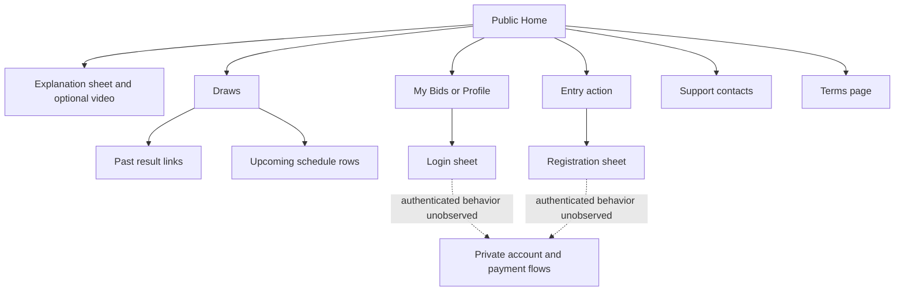

# Onebid public website review

Inspected 23 October 2026: [onebid.et](https://onebid.et/). Purpose: inform an original Lowin interface through public evidence. The user explicitly chose to leave admin design unverified. No admin access was attempted.

## Method and limits

Used the REA reverse-engineering skill and runtime-observation guide. The connected MCP browser scenario captured Home, DOM/accessibility and network metadata. Bundle analysis then closed the MCP transport without a usable result. It was not repeated.

An existing cached REA **6.7.0 CLI** continued without installation or configuration changes. `inspect-web-page` captured 22 script records; 21 same-origin external JavaScript artifacts were retained. Declared `capture-browser-scenario` actions inspected public pages, sheets and account gates. Node searched the retained scripts/CSS for specific fingerprints; these static checks are not execution evidence.

Initial connected-browser screenshots used a desktop viewport with a narrow app column. Separate REA-owned launches established **390 × 844** captures for Home, explanation, support and Amharic. The temporary scenario browsers terminated normally. No account, message, bid, payment, recovery request or form submission was made. The site itself generated analytics and YouTube requests.

Third-party source, screenshots and full captures remain **outside the repository** at `D:/lowin-redesign-qa/onebid-research`. This report contains original analysis only.

## Technology: observed, inferred and unknown

| Finding | Evidence and classification |
| --- | --- |
| React / React DOM | **Observed bundle declarations:** version **19.2.8** in the [main client module](https://onebid.et/assets/index-DvtaRGL2.js) and shared modules. Not a verified package lock. |
| Vite | **Strong static inference:** `__vite__mapDeps`, hashed imports and `VITE_API_BASE_URL` in captured scripts. |
| Tailwind CSS | **Observed declaration:** **4.3.3** attribution in the delivered [stylesheet](https://onebid.et/assets/styles-BYdmUSSQ.css). |
| TanStack Router / Query | **Strong static fingerprints:** router reload/scroll markers, route chunks, QueryClient/provider/cache conventions and stable query keys. Exact versions unknown. |
| TanStack Start | **Inferred:** `TSS_SERVER_FN_BASE` and server-function path configuration. Not proof of a server language or deployment architecture. |
| Fonts | **Observed:** Outfit for display text, DM Sans body text, Noto Sans Ethiopic fallback; Google Fonts requests and stylesheet declarations agree. |
| API boundary | **Observed normal Home requests:** [tenant configuration](https://api.onebid.et/api/tenant/), [payment methods](https://api.onebid.et/api/payment-methods/), [open auctions](https://api.onebid.et/api/auctions/?status=open), [past auctions](https://api.onebid.et/api/auctions/past/). Initial responses returned 200. |
| Delivery / PWA | **Observed:** DigitalOcean Spaces image CDN, Cloudflare stylesheet response, manifest/icons and install-prompt module. Offline operation untested. |
| Backend / administration | **Unknown:** database, server framework, workers, ledger, settlement implementation, hosting origin, staff permissions and admin UI. Client URL conventions do not establish Django, Laravel or Next.js. |

## Customer flow map

## Visible screens and behavior

| Surface | Observed behavior / boundary |
| --- | --- |
| Launch | Small spinner and short loading message; bottom navigation remains visible. Captured sessions resolve to the catalogue; failed-load recovery was not induced. |
| Home | Rounded header, anonymous account actions and language menu; dark promotional photo; brief introduction; sorting chips; single-column auctions; recent results; explanation/footer; fixed navigation and floating support. |
| Current sorting | Default, end-time, recency and fee-order controls. This differs from duration-category chips in the older supplied screenshots. Exhaustive ordering correctness was not tested. |
| Auction cards | Image, status badge, concise title, fee/countdown chips, one dominant entry action and quiet schedule/reference text. Initial Home showed eleven live listings; their operational truth was not independently audited. |
| Learn More | Tall rounded sheet, scrim, close control, YouTube embed, three numbered steps and example panel. Playback, focus trap and keyboard behavior were not exhaustively checked. |
| Anonymous bidding | Entry opens registration. The authenticated bid/payment sheet, authorization, return flow and receipt remain unobserved. |
| Draws | [Past Draws / Upcoming](https://onebid.et/draws) switch between result cards and compact thumbnail/title/schedule/fee/countdown rows. Upcoming was not visibly chronological. Published result amounts and images are publisher claims, not verified settlements or consent. |
| Account sheets | Login has Ethiopian phone prefix, password and recovery entry. Registration has phone/password and a terms link; its agreement checkbox appeared preselected. No credentials or recovery request were submitted. Anonymous My Bids/Profile open login. |
| Support / language | Black floating support opens contact links; none activated. English/Amharic menu changes Home controls and explanatory text to Amharic. Complete translation coverage remains unverified. |
| Legal | Footer exposes [Terms](https://onebid.et/terms), a numbered Amharic article with update date/back navigation. Initially its language control still said English. No privacy link surfaced in inspected Home/terms or captured route strings; this does not prove absence elsewhere. |

Captured client strings also suggest private bids, coupons, referrals, notifications, payment authorization/status and result-number displays. Those are **candidates**, not tested or necessarily enabled features. No public admin link/candidate surfaced within the bounded customer capture; user-confirmed admin scope remains unknown.

## Original Lowin adoption

- Adopt clear hierarchy, compact metadata, consistent spacing, one primary action and restrained sheets. Retain Lowin's logo, assets, words and palette.
- Use real finalized results with masked identities and explicit moderated consent. Do not reuse winner photos or imply independently verified prize delivery.
- Keep public artwork/fonts independent of authentication while preserving exact private API gates and Telegram/contact proof.
- Preserve frozen Lowin rules: **v4 numbers are not charged or reserved; only the disclosed submission fee is deducted**. Onebid's later winner-payment proposition must not change Lowin behavior.
- Keep Lowin's real configured video optional/lazy; preserve server-authoritative ArifPay receipts and disabled funding flags. Reference UI is not payment evidence.
- Keep support discoverable; use explicit agreement and accessible controls rather than copying the observed preselected checkbox.

## Evidence ledger

Files are relative to the external artifact directory above:

| File | REA Evidence ID |
| --- | --- |
| `home-passive.json` | `ev_d7cdad2b3d29aa5390530dd26dd4e7798b987f25e7b3736314534147237e6511` |
| `home-learn-evidence.json` | `ev_278c481ab5a90670a5f26a24864202901966271d90e79e2a4ba96b69394f8a04` |
| `public-flows-evidence.json` | `ev_79f0d4c2ea0984ff05427276801d2f25c95ba4c5dabf8cce0788b64450dfcbab` |
| `mobile-home-learn-evidence.json` | `ev_55d55cf5998fcc901d8272d8fb59ec46b7fb211eb1413476968922684fe1e420` |
| `support-language-evidence.json` | `ev_73864cbeef189c64a4460278c144f1c95367aa07a4c0b5a14936e5bda632c35e` |
| `amharic-evidence.json` | `ev_72b99878ff2e1b9ae33a9499fab19280c02e545f51f171408f3a0dd6ccdb3a9b` |

`script-manifest.json` records retained script digests. Extracted `mobile-home-ready.png`, `mobile-explanation-ready.png`, `mobile-support-ready.png` and account/draw screenshots support visual review.

REA marks scenario records incomplete in the events section despite completed declared steps and requested visual/accessibility captures. No source maps, private accounts, admin screens, real device behavior, p95 latency, settlement integrity or winner consent were verified. This review supports public design observations, not full product or backend reconstruction.
